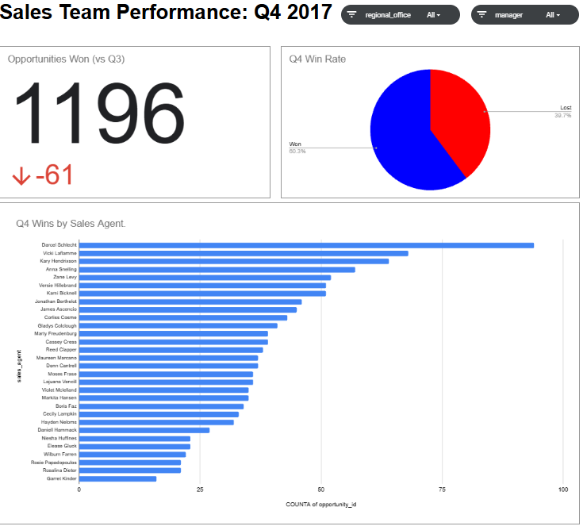
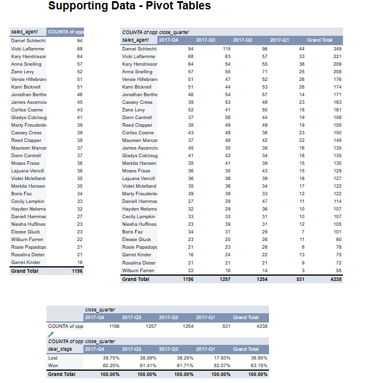
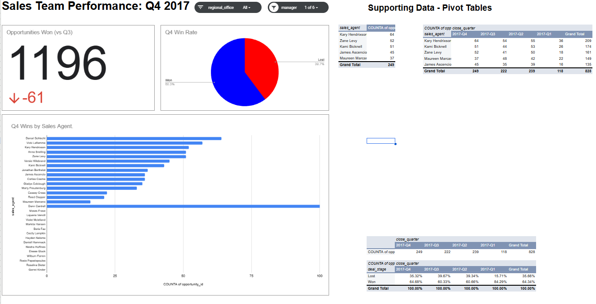

# CRM Sales Dashboard: Quarterly Team Performance

Interactive Google Sheets dashboard for sales managers to track their team's quarterly performance: deals won, win rate and agent rankings, filterable by regional office and manager.

**Live dashboard:** [View in Google Sheets](https://docs.google.com/spreadsheets/d/1cuepT69RPVXrB0XAnNFveP6v-aoHNkcJJ1Y9jcfs61s/edit?gid=1133518882#gid=1133518882)

## Business need
A B2B company selling computer hardware wanted a simple way for sales managers to see how many deals their team won each quarter, whether the win rate is changing, and which agents are leading or falling behind.

## Data
- **sales_pipeline:** 8,800 opportunities across 4 deal stages (Prospecting, Engaging, Won, Lost), closing March to December 2017
- **sales_teams:** each agent's manager and regional office (30 active agents, 6 managers, 3 offices)
- Source: Maven Analytics guided project

## Data preparation
- **Fixed a product name inconsistency:** "GTXPro" vs "GTX Pro" across 1,480 rows, which would have broken any product lookup
- **Checked missing values:** blank close dates and close values belong to open deals (Prospecting or Engaging), so they are expected, not errors
- **Joined the tables:** used VLOOKUP to bring each agent's manager and regional office into the pipeline
- **Added a close_quarter column** to group closed deals by quarter

## Analysis
Pivot tables for:
- Opportunities won by quarter
- Won vs lost rate by quarter
- Opportunities won by agent and quarter

Quarters are sorted newest-first, so the dashboard always shows the latest quarter.

## Dashboard
- **Scorecard:** Q4 wins compared with Q3
- **Pie chart:** Q4 win rate
- **Bar chart:** Q4 wins by sales agent
- **Slicers:** regional office and manager, which filter every visual

Example: filtered to Summer Sewald's team, the top agent is Kary Hendrixson with 64 wins.

## Key insights
- Q4 2017 wins fell to **1,196**, down **61** from Q3 (about 5%)
- The win rate slipped slightly each quarter, from 61.7% in Q2 to **60.3%** in Q4
- **West** had the best Q4 win rate (63.4%), and **East** the lowest (58.2%) with the fewest wins
- **Summer Sewald's** team had the highest Q4 win rate (64.7%), and **Melvin Marxen's** the lowest (55.6%)
- **Darcel Schlecht** was the top agent, with 94 wins in Q4 and 349 for the year

## Recommendations
1. Look into the Q4 dip and the slowly falling win rate before it continues into the next quarter
2. Have the East office and Melvin Marxen's team learn from West and Summer Sewald's team, whose win rates are higher
3. Study what Darcel Schlecht does differently and use it to coach lower-performing agents

## Tools
Google Sheets: VLOOKUP, find and replace, pivot tables, scorecard, pie and bar charts, slicers
